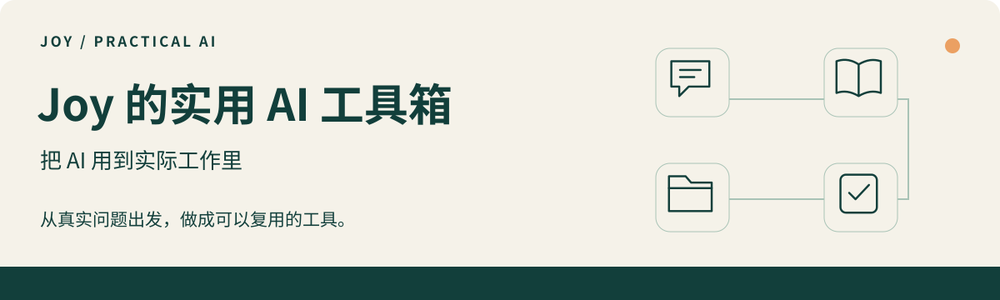

# Joy｜把 AI 用到实际工作里

来自业务一线，分享经过反复打磨的 **Skills、工作流与小应用**。关注具体问题，也关心普通用户能否顺利完成第一次使用。

[**从这里开始 →**](https://github.com/JoyZhang666/joy-agent-skills/blob/main/docs/start-here.md) · [浏览全部作品](https://github.com/JoyZhang666/joy-agent-skills) · [查看使用指南](https://github.com/JoyZhang666/joy-agent-skills/blob/main/docs/start-here.md)

## 🆕 NEW / 近期更新

### [微信公众号写作助手](https://github.com/JoyZhang666/joy-agent-skills/blob/main/kb-to-wechat-article/README.md) · 重点推荐

**把笔记、资料和想法，整理成有依据、好读、方便你修改的公众号文章。**

- **你给什么**：一个主题，或你有权使用的笔记、文字和文件，再说说写给谁看。
- **拿到什么**：标题建议、提纲、Markdown 文章草稿，以及待核对的事实和来源。
- **怎样开始**：新手逐步引导；没有知识库、还没开通公众号，也可以先写第一篇。
- **按需扩展**：配图、排版、Word 定稿转换与手机预览；配置接口并授权后可送草稿箱，公开发表由你完成。

[**跟着指南写第一篇 →**](https://github.com/JoyZhang666/joy-agent-skills/blob/main/kb-to-wechat-article/references/getting-started.md) · [查看完整功能与使用条件](https://github.com/JoyZhang666/joy-agent-skills/blob/main/kb-to-wechat-article/README.md) · [版本变化](https://github.com/JoyZhang666/joy-agent-skills/blob/main/kb-to-wechat-article/CHANGELOG.md)

近期版本 **v4.16.0（2026-10-08）**；本地转换与公众号联调的适用条件、验证范围见项目说明。

---

## 更多精选作品

**[Get 会议行动](https://github.com/JoyZhang666/joy-agent-skills/blob/main/getnote-meeting-actions/README.md)**  
会议结束后，下一步做什么？从会议原文整理有依据的行动清单，按编号推进、续接。

**[Youtube 转写全文稿](https://github.com/JoyZhang666/joy-agent-skills/blob/main/youtube-transcript/README.md)**  
想把视频交给自己或 Agent 细读？输入视频链接，保存为本地 Markdown 全文稿草稿，再对照核验。

**[全书精读工作流](https://github.com/JoyZhang666/joy-agent-skills/blob/main/full-book-deep-reading-workflow/README.md)**  
想认真读完一本书？按章节留下原文定位、笔记和进度，下次从记录继续。

## 按你想做的事，找一个工具

- **内容创作** · [微信公众号写作助手](https://github.com/JoyZhang666/joy-agent-skills/blob/main/kb-to-wechat-article/README.md)
- **会议与执行** · [Get 会议行动](https://github.com/JoyZhang666/joy-agent-skills/blob/main/getnote-meeting-actions/README.md)
- **知识与阅读** · [视频全文稿](https://github.com/JoyZhang666/joy-agent-skills/blob/main/youtube-transcript/README.md) / [全书精读](https://github.com/JoyZhang666/joy-agent-skills/blob/main/full-book-deep-reading-workflow/README.md) / [GetNote 知识库整理](https://github.com/JoyZhang666/joy-agent-skills/blob/main/getnote-knowledge-manager/README.md)
- **文档生成** · [适合手机阅读的 PDF 生成器](https://github.com/JoyZhang666/joy-agent-skills/blob/main/mobile-pdf-report/README.md)
- **日常管理** · [项目文件管理](https://github.com/JoyZhang666/joy-agent-skills/blob/main/project-file-management/README.md) / [课程课时台账](https://github.com/JoyZhang666/joy-agent-skills/blob/main/class-hours-ledger/README.md)
- **技术工具 · 进阶** · [mihomo 安装与运维](https://github.com/JoyZhang666/joy-agent-skills/blob/main/mihomo-vpn-install/README.md) / [Crossborder Tunnel Kit（实验性）](https://github.com/JoyZhang666/joy-agent-skills/blob/main/crossborder-tunnel-kit/README.md)

## 实践手记

把调教工具的判断过程也留下来。

- [返回了文字，为什么还不能算“全文交付”？](https://github.com/JoyZhang666/joy-agent-skills/blob/main/docs/notes/transcript-completeness.md)
- [一个 Skill 公开前，如何检查隐私与来源？](https://github.com/JoyZhang666/joy-agent-skills/blob/main/docs/notes/publish-with-care.md)
- [怎样让第一次配置 API 的人走完最后一步？](https://github.com/JoyZhang666/joy-agent-skills/blob/main/docs/notes/first-api.md)

## 使用与反馈

先从一份新手指南完成小任务，再按需配置知识库、图片工具或其他接口。各作品的版本、依赖、实测范围与限制，以项目说明和版本记录为准。

欢迎用[虚构或脱敏示例反馈问题](https://github.com/JoyZhang666/joy-agent-skills/issues)，一起把工具磨得更好用。请勿提交私稿、客户资料或登录密钥。
